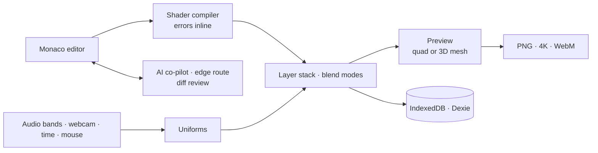

<div align="center">



<p>
  <a href="https://fragment-ashy.vercel.app"></a>
  
  
  
</p>

<p><em>A premium GLSL editor with an AI co-pilot, a real 3D viewport,<br>
audio- and camera-reactive uniforms and a multi-layer compositor.</em></p>

</div>


## What it is

Classic shader playgrounds stop at a fullscreen quad with no helpers. FRAGMENT puts shaders on real geometry, stacks them like image layers and gives you a co-pilot that edits your code and shows you the diff before you accept it. It runs at 60 fps in the browser.


## Features

| | |
|---|---|
| **AI co-pilot** | <kbd>⌘</kbd> <kbd>⇧</kbd> <kbd>A</kbd>, type *"make it more dreamy"*, review the diff, accept. |
| **3D viewport** | Apply the shader to a sphere, torus, knot or cube, with orbit controls. |
| **Multi-layer** | Stack shader layers like an image editor, with 12 blend modes. |
| **Audio reactive** | Microphone or MP3 into three automatic bands: `u_audio_low`, `u_audio_mid`, `u_audio_high`. |
| **Webcam texture** | The live camera feed arrives as `sampler2D u_camera`. |
| **Inline docs** | Hover any GLSL function for its signature, description and an example. |
| **Export** | PNG, 4K PNG and looping WebM, straight from the browser. |
| **Gallery** | Share shaders and explore other people's. |
| **Local first** | Projects saved in IndexedDB (Dexie); the AI endpoint runs on the edge. |


## How it fits together




## Uniforms you get for free

Every shader is compiled with a standard header, so these are always there:

| Uniform | Value |
|---|---|
| `u_time` · `u_frame` | Seconds since start, frame count |
| `u_resolution` · `u_dpr` | Canvas size in pixels, device pixel ratio |
| `u_mouse` · `u_mouse_delta` | Pointer position and its movement since the last frame |
| `u_audio_low` · `u_audio_mid` · `u_audio_high` | Three bands from the microphone or an MP3 |
| `u_audio_tex` | The full spectrum as a texture |
| `u_camera` | The live webcam feed as a `sampler2D` |

Declare your own and annotate it, and a slider appears in the panel:

```glsl
uniform float u_warp;   // @min: 0.0 @max: 4.0 @step: 0.05
```

Compile errors are parsed out of the GLSL log and shown inline on the right line.


## Layers, post-fx and the co-pilot

| Piece | Detail |
|---|---|
| **Blend modes** | Normal, multiply, screen, overlay, darken, lighten, colour dodge, colour burn, hard light, soft light, difference, exclusion. |
| **Post-fx** | Bloom (intensity, threshold), chromatic aberration, vignette, film grain, pixelation and scanlines, each off by default. |
| **Co-pilot** | An edge route sends your code and request to Claude (Sonnet) when `ANTHROPIC_API_KEY` is set. The answer comes back as a diff you accept or reject; nothing replaces your code silently. |
| **Sharing** | A share creates a short `/s/<id>` link stored in Vercel KV for a year. The shader is also encoded into the URL, so a link still works where KV is not configured. |
| **Saving** | Projects live in IndexedDB through Dexie and autosave every 30 seconds. |
| **Learn** | A `/learn` page with examples to start from. |


## Türkçe özet

**FRAGMENT**, 2026 için yeniden düşünülmüş bir GLSL shader editörü. Shader'ı yalnızca düz bir ekranda değil küre, torus ya da küp üzerinde görebiliyor, katmanları 12 karışım moduyla üst üste koyabiliyorsun. Mikrofon ve kamera doğrudan uniform olarak shader'a geliyor. Yapay zekâ yardımcısı koduna istediğin değişikliği yapıyor ve onaylamadan önce farkı gösteriyor. Sonucu PNG, 4K ya da WebM döngü olarak indirebilirsin.


## Development

```sh
pnpm install
cp .env.local.example .env.local   # ANTHROPIC_API_KEY, optional Vercel KV for short links
pnpm dev                           # http://localhost:3000
pnpm build
```

```
components/editor/    Monaco setup, GLSL language, inline docs
components/preview/   canvas, 3D viewport, layer compositor
components/panels/    uniforms, inputs, layers, export
lib/shader/           compiler, uniforms, templates
lib/storage/          Dexie projects and gallery client
app/api/              AI co-pilot and share routes
```

<div align="center">
<br>
<a href="https://github.com/kutluhangil"></a>
<sub>MIT licensed · Write a fragment. Ship a world. · the code in the banner is illustrative.</sub>
</div>
